# Dragon Ball Online Offline (DBOFF) - Godot 4 架构设计与施工方向路线图

## 1. 总体设计原则与核心定位

本项目旨在将《龙珠Online》（Dragon Ball Online, DBO）原版庞大的 C++/RenderWare 客户端与分布式服务器架构，重构精简为一套基于 **Godot 4（Jolt Physics + Forward+ / D3D12）** 的**高性能单机离线轻量化 RPG 框架**。

### 核心设计原则
1. **轻量化与资源解耦**：
   - 彻底摒弃传统“模型+动画+骨骼打成一个大文件”的做法。
   - 骨骼与动画轨（`.glb` 仅含 Skeleton 与 Animation Tracks）作为独立共享的 `AnimationLibrary`；
   - 网格（Mesh）与贴图（Texture）完全剥离复用；
   - 保证 Godot 打开工程时索引轻量、极速导入，不卡死未响应。
2. **逻辑与表现解耦（仿 OpenDBO-Core 仿真层）**：
   - 参考 OpenDBO-Core 的 `NtlSimulation` 与 `GameServer` 实体交互逻辑；
   - 单机离线版无需网络传输序列化协议，而是在 Godot 本地内存中通过“逻辑组件驱动视图（Model-View-Component）”运行，免除网络延迟与封包编解码损耗。
3. **数据驱动与严格零文本硬编码**：
   - 核心规则由 `assets/tbl/`、`assets/prop/property/`、`data/terrain/` 的 JSON 驱动；
   - 界面所有文本一律基于 `table_text_all_data.json` 索引，通过多语言标签管理器动态下发。

---

## 2. OpenDBO-Core 原版架构对比与 Godot 4 映射设计

| 系统模块 | OpenDBO-Core 原版 C++ 架构 | DBOFF (Godot 4 离线版) 重构映射方案 | 优势对比 / 性能收益 |
| :--- | :--- | :--- | :--- |
| **网络与运行拓扑** | 5 大分布式服务端进程 + RenderWare 客户端 Win32 消息循环 | **单进程内部逻辑闭环**：单机服务调度总线 (`GameDirector`) + 本地事件广播 | 零网络发包开销，无断网/卡包问题，启动仅需 1 秒 |
| **动画系统** | `CNtlPLAnimSet` + `CNtlTypeAnimTable` + Clump/Hierarchy 骨骼硬绑定 | **Godot 4 AnimationLibrary + 共享 Skeleton3D** 纯骨骼动画库按种族共享，身体部件换装只需挂接同一 Skeleton | 内存占用降低 80% 以上，避免成千上万个带网格的重复动画文件 |
| **动画事件机制** | `SEventAnimHit`, `SEventFootStep`, `SEventVisualEffect` 二进制硬解析 | **自定义 AnimationTrack / Method Call 轨道 + `characterproperty.json` 帧字典** | 毫秒级攻击判定、气功波弹道发射、受击震屏精准复刻 |
| **场景与地形管理** | `CNtlWorld` 四叉树 + Sector/Cell 切块 + PVS 剔除 | **动态区块流式加载 (`WorldChunkManager`) + Jolt 3D 高度场碰撞体** | 50 块大地图无需一次性加载进内存，仅按玩家视距流式常驻 9 宫格 |
| **数据与本地化** | 加密 `tbl.pak` + `CNtlTableContainer` 启动全量加载 | **按需惰性加载 (`DBOTableManager`) + 标签化本地化代理 (`DBOLocalizer`)** | 消除启动内存膨胀，多语言热切换自由修改样式 |
| **实体行为控制** | `CNtlSobActor` + `NtlBehaviorChar` 状态机 | **节点化状态机 (`CharacterStateMachine`) + 视线感知区域 (`Area3D`)** | 模块化清晰，方便自由扩展新技能、新状态 |

---

## 3. DBOFF 核心架构拓扑图

```mermaid
flowchart TD
    subgraph DataLayer ["1. 数据与资源层 (Data & Resource Layer)"]
        TBL["Tbl JSON (属性/数值/经验/技能)"]
        PROP["Prop JSON (角色帧事件/装备挂点/场景碰撞)"]
        TEXT["Text JSON (官方全并集繁体映射库)"]
        TERRAIN["Terrain JSON (高度场/地表材质/物体摆放)"]
        
        DBOTableMgr["DBOTableManager (单例/惰性字典缓存)"]
        DBOLocalizer["DBOLocalizer (标签化多语言翻译器)"]
        
        TBL --> DBOTableMgr
        PROP --> DBOTableMgr
        TERRAIN --> DBOTableMgr
        TEXT --> DBOLocalizer
    end

    subgraph WorldLayer ["2. 大世界流式管线 (World Streaming Pipeline)"]
        WorldMgr["WorldChunkManager (视距调度器)"]
        TerrainChunk["TerrainChunk3D (九宫格网格动态加载)"]
        PropsSpawner["WorldPropManager (复用 4504 个独立 glb)"]
        NavServer["NavigationServer3D (区域寻路网格)"]
        
        WorldMgr --> TerrainChunk
        WorldMgr --> PropsSpawner
        WorldMgr --> NavServer
    end

    subgraph EntityLayer ["3. 角色与实体层 (Entity & Animation Layer)"]
        CharBase["CharacterBase3D (玩家/NPC/怪物抽象基类)"]
        SkelTree["Skeleton3D (种族通用骨骼根节点)"]
        AnimLib["AnimationPlayer + AnimationLibrary (轻量无网格动画轨)"]
        MeshSlots["换装网格槽 (Head/Torso/Legs/Hands/Feet/Weapon)"]
        EventDispatcher["AnimEventDispatcher (攻击点/震屏/光效/脚步发信器)"]
        FSM["StateMachine (Idle/Run/Attack/KnockDown/ChargeKi)"]
        
        CharBase --> SkelTree
        CharBase --> AnimLib
        CharBase --> MeshSlots
        CharBase --> EventDispatcher
        CharBase --> FSM
    end

    subgraph SystemsLayer ["4. 战斗与交互逻辑层 (Combat & Interaction Systems)"]
        CombatEngine["CombatEngine (伤害公式/暴击/格挡/击飞向量)"]
        ProjectileMgr["ProjectileManager (气功弹/魔贯光杀炮/光束弹道)"]
        CameraDirector["CinematicCamera3D (自由视角 + 样条过场导轨)"]
        QuestSystem["QuestEngine (对话/触发器/击杀计数)"]
    end

    subgraph UILayer ["5. 界面表现层 (UI & HUD Layer)"]
        HUD["HUD (生命/气力/RP球/迷你地图)"]
        BagUI["InventoryUI (背包/装备穿戴/强化预览)"]
        DialogUI["DialogueBox (NPC 对话特写镜头 + 选项分支)"]
    end

    DBOTableMgr --> CombatEngine
    DBOTableMgr --> QuestSystem
    DBOLocalizer --> UILayer
    WorldMgr --> CharBase
    EventDispatcher --> CombatEngine
    EventDispatcher --> ProjectileMgr
    CombatEngine --> CameraDirector
    CharBase --> HUD
    DialogUI --> CameraDirector
```

---

## 4. 模块施工细则与实现方案

### 4.1 动画与网格管线施工：纯骨骼动画库解耦方案
- **实现原理**：
  1. 官方 DBO 骨骼按**种族与体型**归类（如人族男成体 `H_M`、魔人男 `M_M`、那美克 `N_M`）。
  2. 我们将导出的 `.anm` 转换为仅包含骨骼层次变换（平移、旋转、缩放曲线）的轻量级 `.glb` 文件。
  3. 在 Godot 中，一个种族只需一个标准 `Skeleton3D` 模板。将动作转换为 `AnimationLibrary`。
  4. 角色的头部、躯干、腿部等装备模型（由原版 DFF 提取的独立网格）直接作为 `MeshInstance3D` 挂入，设置其 `skeleton` 路径指向统一的 `Skeleton3D`。
- **性能优势**：
  - 单个动作动画文件通常仅 **几 KB ~ 十几 KB**；
  - 角色换装时，无需为每套衣服复制一份骨骼动画，彻底根治文件冗余与 Godot 导入卡顿。

### 4.2 角色动作事件触发驱动 (`AnimEventDispatcher`)
结合刚刚解出的 `characterproperty.json`，在角色播放动画时建立精确响应：
- 当播放攻击动作触发 `EVENT_ANIM_HIT` 时：
  - 提取 `hand_type` 与 `chBoneName` 确定发射骨骼或打击位置；
  - 检查 `projectile_effect_type`：若为气功波，由 `ProjectileManager` 实例化飞向目标；若为近战，进行扇形范围碰撞检测；
  - 若受击方触发 `TARGET_BEHAVIOR_PUSH` 或 `KNOCK_DOWN`，由物理系统给受击者施加击飞后退向量冲量（Impulse）；
  - 若 `camera_shake` 为真，通知主相机按 `camera_shake_factor` 震动。
- 当触发 `EVENT_ANIM_FOOT_STEP` 时：
  - 投射向下短射线（RayCast3D）检测地面材质（草地、石板、泥土、水面），播放对应的脚步音效并触发扬尘粒子。

### 4.3 地形与场景物件流式加载 (`WorldChunkManager`)
- 龙珠大世界由多块 1024×1024 大地图拼接而成。
- 基于刚刚纠正的 `data/terrain/` 地图 JSON 和 `assets/prop/property/objectproperty.json`：
  1. 将世界划分成多个 128×128 的 Chunk；
  2. 玩家移动跨界时，根据玩家九宫格动态 `load_threaded_request` 预加载邻近 Chunk；
  3. 远距离物件根据 `objectproperty.json` 中的 `culling_distance` 自动开启视距剔除，静态物件开启网格合并或多实例渲染（MultiMeshInstance3D），确保高帧率流畅运行。

### 4.4 导演过场与特写运镜系统 (`CinematicDirector`)
- 基于 `direct_splines.json` 和 `direct_project.json`：
  - 在 Godot 中构建 `CameraSplineController`；
  - 读取 679 条预置样条轨迹，构建 `Path3D` 节点；
  - 剧情过场（TMQ）或绝招特写触发时，切换为主摄像机吸附在 `PathFollow3D` 上，平滑插值旋转四元数，还原动漫级演出镜头。

---

## 5. 项目施工目标规划与进度追踪

### 阶段目标追踪清单

- [x] **阶段 0：基础数据与属性资产准备（已全部完成）**
  - [x] 官方全并集多语言本地化映射表提取导出 (`assets/tbl/table_text_all_data.json`)
  - [x] 核心数值与逻辑规则表格全量导出 (`assets/tbl/*.json`)
  - [x] 50 块大世界完整地形与地表数据纠正导出 (`data/terrain/*.json`)
  - [x] 原版 4,504 个独立场景物件无损导出与路径纠正 (`assets/obj/object/mesh/*.glb`)
  - [x] 6 大角色动作帧事件、装备槽位、场景物理与导演样条属性全量导出 (`assets/prop/property/*.json`)

- [x] **阶段 1：底层核心单例与数据服务搭建（已全部完成，对标 OpenDBO 零硬编码）**
  - [x] `DBOTableManager.gd`：数值表格、属性配置字典的惰性按需读取与检索 API
  - [x] `DBOLocalizer.gd`：基于标签分类与语言代码的文本下发器（杜绝任何文本硬编码，纯标签动态驱动）
  - [x] `AudioManager.gd`：全量音频（13 类子库）调度器、BGM 交叉渐变与 3D 空间音效定位

- [x] **阶段 2：全量 25,768 个 3D 资产纯净预导入与骨骼/网格/动画库解耦（已全部完成）**
  - [x] 全工程 25,768 个 GLB 资产 100.00% 无死循环预导入 (`.import` + `.godot/imported/*.scn`)
  - [x] 修复 21 个底层 IEEE 754 `NaN` 浮点死循环异常模型（彻底解决引擎 AABB 陷入无限循环卡死）
  - [x] 规范化 15,854 个 glTF 2.0 规范 4 字节空格对齐 (`0x20`)
  - [x] 通用角色部件换装组装工厂 `CharacterFactory.gd` 与 `CharacterVisual.gd`（多部件挂载同 Skeleton3D）
  - [x] 动作事件响应器 `AnimEventDispatcher.gd`（打击帧/脚步帧/发射帧响应）

- [x] **阶段 3：大世界地形流式与场景调度（核心框架已完成）**
  - [x] 地形高度场网格与法线重建器 `WorldTerrainMeshBuilder.gd`
  - [x] 场景物件多实例与视距裁切实例化调度器 `WorldPropManager.gd`（4504 个独立场景物件）
  - [x] 玩家九宫格动态流式加载管理器 `WorldChunkManager.gd` 与主世界驱动 `WorldSceneDriver.gd`
  - [x] 真实天空盒环境驱动 `WorldSkybox.gd`

- [ ] **阶段 4：仿 OpenDBO 正统战斗交互闭环与行为状态机（当前重点推进）**
  - [x] `DBOFormulaEngine.gd`：严格对标 OpenDBO-Core（等级动态最大连击数、穿透防御、浮动修正、6x6属性相克）
  - [x] `PlayerController3D.gd`：无硬编码操作输入系统（对齐 DBO 官方键位：Tab 选怪、F 攻击/连击、Z 聚气/蓄气、X 坐下/休息、R 战术防御）
  - [x] `CombatEngine.gd` & `Projectile3D.gd`：近战判定、击退击飞冲量与气功波弹道物理投射
  - [x] `DBOBuffComponent.gd` & `DBOAspectComponent.gd`：Buff 持续效果/属性修正与体型变身外观组件
  - [ ] 实体目标选择与锁定反馈状态同步（目标头顶状态、视线感知判定、距离衰减）
  - [ ] 怪物自主 AI 状态机（巡逻/追击/攻击/脱战回血，对标 OpenDBO `BotState_*.cpp`）
  - [ ] 技能施法管线对接（技能冷却表、施法消耗、咏唱状态打断与施法动画绑定）

- [ ] **阶段 5：基础 GUI 与剧情导演演出（后续推进）**
  - [x] `DBOHUD.gd`：零硬编码标签化状态栏（生命槽、气力槽、RP 气珠槽、目标信息框）
  - [x] `CameraSplinePlayer.gd`：基于 `direct_splines.json` 的摄像机样条运镜播放器
  - [ ] NPC 对话特写镜头与任务分支交互界面（全文本经由 `DBOLocalizer` 动态解析）
  - [ ] 背包与装备穿戴动态换装实时联动
