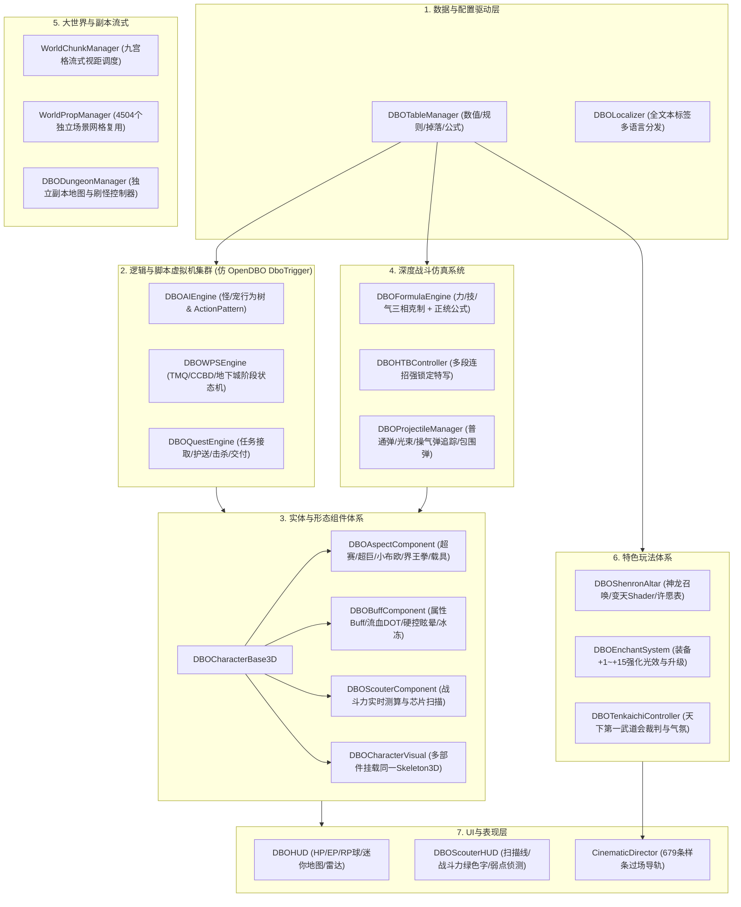

# OpenDBO-Core 源码全景深度剖析与 Godot 4 全系统闭环架构设计

## 1. 深度源码剖析：前一版架构与 OpenDBO-Core 的差距评估

前一阶段所搭建的架构（`DBOTableManager`、`DBOLocalizer`、`DBOCharacterVisual`、`AnimEventDispatcher`、`WorldChunkManager` 等）构成了**“Level 1 基础设施层”**（完成了数据驱动底座、资源加载、网格解耦与动作分发）。

但若要**100% 完整复刻 OpenDBO-Core 的所有游戏机制**，经过对 `E:\OpenDBO-Core-master` 核心源码（包括 `DboServer/Server/GameServer/` 下 300 多个逻辑文件与 `DboShared/DboTrigger/` 触发体系）的深度挖掘，目前还存在 **8 大核心系统断层** 亟需补齐架构。

---

## 2. OpenDBO-Core 核心模块全景剖析与源码对照

### 2.1 触发器四大脚本虚拟机引擎 (Trigger Scripting Systems)
在 `E:\OpenDBO-Core-master\DboServer\Server\GameServer` 与 `DboShared\DboTrigger` 中，存在 DBO 最核心的 4 套自动化状态机虚拟机：
1. **AIS (AI Script - 怪物与宠物行为树)**：
   - 核心文件：`AISManager.cpp`, `AISNodeAction_*.cpp`, `AISNodeState_*.cpp`, `ActionPatternSystem.cpp`
   - 机制：怪物不是简单的巡逻和追击，而是通过 AIS 节点驱动：非战斗闲逛（`AISNodeState_Wander`）、受击反击（`AISNodeState_Fight`）、战术撤退/求援（`BotAiAction_Flee`）、技能施放决策（`AISNodeAction_UseSkill`）、回血脱战（`AISNodeState_Comeback`）。
2. **WPS (World Play Script - 世界与地下城规则驱动引擎)**：
   - 核心文件：`WorldPlayScriptManager.cpp`, `WPSNodeGameStage.cpp`, `WpsAlgoStage.cpp`, `WpsNodeAction_CCBD_*.cpp`
   - 机制：驱动时光机副本（TMQ）、胶囊公司战斗地下城（CCBD）、道场争夺战的阶段演进（`StagePrepare` -> `StageRun` -> `StageClear` / `StageFailed`）、刷怪波次、限时倒计时、全灭判定。
3. **TQS / TS (Trigger Quest Script - 任务条件引擎)**：
   - 核心文件：`DboTSAct*.cpp`, `DboTSCheck*.cpp`
   - 机制：涵盖对话分支、护送 NPC（`DboTSActEscort`）、区域进入事件（`AreaEnter`）、击杀指定计数、收集龙珠任务。
4. **SPS (Script Play System - NPC 剧情演出脚本)**：
   - 驱动场景中巡回 NPC 的特定演出巡逻路线、台词对话与世界事件。

### 2.2 角色形态变身系统 (Aspect State System)
在 `E:\OpenDBO-Core-master\DboServer\Server\GameServer\AspectState*.cpp` 中：
- `AspectState_SuperSaiyan`：**超级赛亚人变身**。触发金色爆气光柱、头发网格替换为金色竖发（`H_M_Hair_SS`）、角色属性爆发性加成、持续消耗气力（EP）、攻击音效替换。
- `AspectState_GreatNamek`：**那美克星人超巨体化**。角色模型比例缩放 4~6 倍、攻击范围（AOE 半径）大幅提升、脚步附带强烈震屏与泥土撕裂音效。
- `AspectState_PureMajin`：**纯粹魔人变身（魔人变身为小布欧形态）**。模型全身替换为纯粹魔人、重置动作集（纯粹魔人专属狂暴攻击模式）、解锁专属糖果光线（`Candy Ray`）。
- `AspectState_Kaioken`：**界王拳状态**。红色上升气柱粒子、攻击与移速暴增、每秒固定扣除百分比生命值（HP Drain），需要玩家在气血见底前解除。
- `AspectState_Vehicle`：**胶囊载具模式**。收起武器装备，挂接悬浮机车/单轮摩托，移速提升至 150%~200%，受到攻击判定自动击落并解除载具。

### 2.3 状态异常与持续效果容器 (Buff & Condition System)
在 `BuffManager.cpp`, `Buff.cpp`, `NtlSharedDef.h` 中：
- **属性增益/减益**：持续加攻防、暴击率、移动速度。
- **持续伤害/回复 (DOT / HOT)**：流血（Bleed）、中毒（Poison）、灼烧（Burn）、气力回复（EP Regen）。
- **完全控制型硬控 (Hard CC)**：
  - `CHARCOND_FLAG_STUN`（眩晕：打断施法，无法移动与攻击）
  - `CHARCOND_FLAG_SLEEP`（催眠：受到伤害立刻被打醒）
  - `CHARCOND_FLAG_PARALYZE`（麻痹：行动受限）
  - `CHARCOND_FLAG_CONFUSED`（混乱：反向操作）
  - `CHARCOND_FLAG_TERROR`（恐惧：不受控制四处逃窜）
  - `CHARCOND_FLAG_TAUNT`（强制嘲讽转移目标）
  - `CHARCOND_FLAG_CANDY`（被魔人变成糖果：无法攻击，防御降低）

### 2.4 正统战斗与公式机 (Authentic Formulas in `battle.cpp` & `td_formula.json`)
OpenDBO 拥有非常严密的剪刀石头布克制与等级衰减算法：
- **相克属性 (Battle Attribute Triad)**：
  - 力（Honorable / Power）克制 气（Energy）
  - 气（Energy）克制 技（Dexterity / Skill）
  - 技（Dexterity）克制 力（Power）
  - 属性克制造成额外 +15% 伤害增幅与受创加深。
- **物理与能量防御穿透公式 (`battle.cpp:167`)**：
  $$\text{Damage} = \text{AttackerPower} \times \left(1.0 - \frac{\text{TargetDef}}{\text{TargetDef} + \text{AttackerLevel} \times \text{FormulaRate}[3100][1]}\right)$$
- **命中与闪避几率公式 (`battle.cpp:64`)**：
  $$\text{HitRate} = 100.0 - \left(\text{FormulaRate}[3700][1] \times \frac{\text{Hit}}{\text{Hit} + \text{Dodge}} \times \frac{\text{AttackerLv} + 1}{\text{AttackerLv} + \text{TargetLv}} \times 100.0\right)$$
- **格挡防御 (`battle.cpp`)**：格挡成功减免固定百分比（由盾牌与格挡率决定），并触发武器相撞火花音效。

### 2.5 战斗力探测器系统 (Scouter System)
- `Scouter.cpp`, `table_item_data.json`
- **战斗力算法 (Battle Power Formula)**：综合生命、气力、物理攻击、能量攻击、攻速、暴击率，计算出龙珠标志性的战斗力数值（例如拉蒂兹 1,500，栽培人 1,200）。
- **探测器芯片 (Scouter Chips)**：插装芯片提供侦测敌对阵营、显示怪物弱点、扫描怪物背包掉落物、远距离探测警报等 HUD 扫描线视觉效果。

### 2.6 七龙珠许愿与神龙召唤 (Dragon Ball & Shenron System)
- `DragonBall.cpp`, `table_dragon_ball_data.json`, `table_db_reward_data.json`
- 收集 7 颗龙珠，前往神龙祭坛（神龙祭坛坐标在地形中已定义）；
- 插入 7 颗龙珠，天空变暗（环境光从昼光变为乌云雷电环境 Sky Shader）；
- 触发 `direct_splines.json` 中神龙腾空升起的 3D 摄像机演出；
- 弹出神龙许愿界面（转生职业专属终极必杀技、强力神装、洗点、超级金币包）；
- 许愿完成神龙化作 7 颗石化龙珠飞散大世界。

### 2.7 HTB（High Tension Battle）连击必杀技系统
- `HtbSkill.cpp`, `HtbSkillManager.cpp`, `table_htb_set_data.json`
- 消耗 100/200/300 RP 点数激活；
- 触发强锁定状态（目标无法移动，进入连续硬直）；
- 多段连招攻击动作连续衔接（连续踢飞、瞬移空中追击、下劈砸坑、最终气功波贯通）；
- 摄像机全程按样条曲线推拉特写。

### 2.8 装备强化与洗练 (Enchant / Upgrade System)
- 装备 +1 到 +15 逐级强化系统；
- 成功率衰减、失败降级、爆装惩罚；
- 对接 `itemproperty.json` 的 16 级光效粒子名，武器从 +4 发白光、+7 发蓝光、+10 发紫光、+12 发橙光、+15 发烈焰红光。

---

## 3. Godot 4 下的全系统闭环架构拓扑图

为了完整包容上述所有 OpenDBO-Core 游戏机制，系统架构扩展为以下 7 大层次：

---

## 4. 全功能施工路线图与阶段清单

- [x] **基础数据与资产阶段（已 100% 达成）**
  - [x] 官方多语言映射表全量导出 (`table_text_all_data.json`)
  - [x] 核心数值表、公式表导出 (`assets/tbl/`)
  - [x] 50 块大世界地形数据纠正 (`data/terrain/`)
  - [x] 4,504 个独立场景物件无损转码 (`assets/obj/world/mesh/`)
  - [x] 6 大属性、骨骼动作帧事件与运镜样条数据全量导出 (`assets/prop/property/`)

- [x] **阶段 1：底层基础设施单例（已完成）**
  - [x] `dbo_localizer.gd`（零文本硬编码、标签多语言服务）
  - [x] `dbo_table_manager.gd`（惰性缓存、OpenDBO 表格查询接口）
  - [x] `audio_manager.gd`（BGM 交叉淡入淡出、3D 空间音效定位）
  - [x] 基础角色基类、多部件换装与大世界流式骨架

- [ ] **阶段 2：OpenDBO 核心战斗机与 Buff 状态容器**
  - [ ] 编写 `src/combat/dbo_formula_engine.gd`：完全植入 `battle.cpp` 的力/技/气三相克制算法、命中闪避公式、物理能量穿透公式。
  - [ ] 编写 `src/entities/dbo_buff_component.gd`：实现持续状态容器（眩晕、催眠、麻痹、流血、变糖果、持续回复）。
  - [ ] 编写 `src/combat/dbo_htb_controller.gd`：对接 `table_htb_set_data.json` 实现多段连击 QTE 判定与电影级镜头推进。

- [ ] **阶段 3：五大形态变身系统 (Aspect States)**
  - [ ] 编写 `src/entities/dbo_aspect_component.gd`
  - [ ] 实现超级赛亚人变身（金色发型替换、金色爆气光效、属性大幅增幅、EP 持续消耗）
  - [ ] 实现那美克星人超巨体化（体型放大 5 倍、AOE 范围扩大、震屏脚步）
  - [ ] 实现纯粹魔人变身（小布欧外观替换、狂暴体术动作组、糖果光线）
  - [ ] 实现界王拳（红色气柱、HP 持续掉血、爆发加成）
  - [ ] 实现胶囊载具（悬浮机车挂载、骑乘移速与受创击落）

- [ ] **阶段 4：自动化脚本虚拟机 (AIS / WPS / TQS)**
  - [ ] 编写 `src/ai/dbo_ai_engine.gd`：怪物的行为树决策（巡逻、索敌视线、追击、求援、技能施放、回程）
  - [ ] 编写 `src/dungeon/dbo_wps_engine.gd`：副本演进状态机（阶段倒计时、波次怪物刷新、全灭胜负判定）
  - [ ] 编写 `src/quest/dbo_quest_engine.gd`：任务进度监听（NPC 对话、杀怪计数、道具收集、护送）

- [ ] **阶段 5：龙珠三大核心特色玩法**
  - [ ] 编写 `src/gameplay/dbo_scouter_system.gd`：战斗力探测器扫描与 HUD 绿色侦测视效。
  - [ ] 编写 `src/gameplay/dbo_shenron_altar.gd`：七龙珠集齐祭坛交互、变天 Shader 切换与神龙许愿系统。
  - [ ] 编写 `src/gameplay/dbo_enchant_system.gd`：装备 +1~+15 强化几率与 `itemproperty.json` 16 级光效切换。
  - [ ] 编写 `src/gameplay/dbo_tenkaichi_arena.gd`：基于 `tenkaichi_direction.json` 的天下第一武道会赛场裁判与观众气氛调度。
