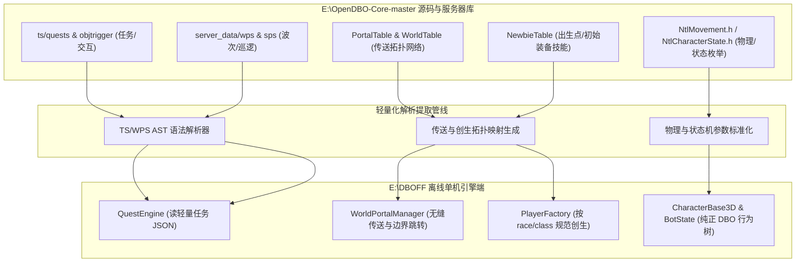

# OpenDBO-Core 源码与服务端运行时数据深度评估报告

> **评估目标**：全面核查 `E:\OpenDBO-Core-master` 源码仓库，评估其中是否存在客户端资产之外的**服务器专有数据、跳转与传送接口、初始创生规则、任务/剧本逻辑以及 C++ 硬编码机制**，并制定轻量化离线单机还原的提取与映射方案。

---

## 1. 核心结论与资产层级评估

通过对 `E:\OpenDBO-Core-master`（涵盖 `DboServer`、`DboShared`、`DboClient`、`Database` 及 `ExecutionEnv`）全量代码与资源目录的系统化解构，得出明确结论：

> **OpenDBO-Core 中存在大量无法仅从客户端提取的核心逻辑数据与跳转机制！**  
> 原版网游为防止客户端作弊，将大量关键机制（任务触发器、副本波次事件、NPC行为巡逻、传送接口拓扑网、角色创生预设）全部放在了**服务端资源目录 (`ExecutionEnv/resource`)** 与 **C++ 核心代码** 中。对于构建无需服务器进程的纯净轻量化 Godot 离线单机版而言，这些数据是**不可或缺的灵魂支柱**。

---

## 2. 需从服务端提取与转换的资产分类全景

### 2.1 第一大类：服务端专属脚本系统（动态逻辑的核心）

在 `DboServer/ExecutionEnv/resource/` 下存放着原版私服/官方用于驱动世界运转的五套核心脚本，均为文本 DSL / Lua 架构：

| 资源路径 | 数量 / 规模 | 脚本类型 | 核心职责与数据内容 | 单机离线重构建议 |
| :--- | :--- | :--- | :--- | :--- |
| `resource/ts/quests/*.t` | **2,886 个** | **任务触发脚本 (Trigger System - TS)** | 定义了全游戏所有任务的触发条件（NPC 对话交互、击杀特定怪、收集道具、侦察镜 Scouter 扫描、到达特定坐标）、分支步骤与最终奖励下发。 | 解析其 `CNtlTSTrigger` AST 语法树，转为 Godot 轻量 JSON 任务图，由单机 `QuestEngine` 驱动。 |
| `resource/ts/objtrigger/*.t` | **564 个** | **物件交互触发器 (Object Trigger)** | 场景可交互实体（机关门、神龙许愿祭坛、宝箱开启动画、副本升降梯、场景传送光圈）。 | 解析与场景物件绑定，驱动玩家接近按互动键时的机关动作与开箱掉落。 |
| `resource/ts/pctrigger/*.t` | **154 个** | **玩家自身触发器 (PC Trigger)** | 角色转职仪式、新手教学引导、特定等级解锁成就。 | 接入 `PlayerController3D` 的等级与事件监听总线。 |
| `resource/server_data/wps/wps/*.wps` | **524 个** | **世界进程脚本 (World Play Script)** | 地下城与活动副本的波次管理（如 CCBD 胶囊公司爬塔每一层的怪物生成、限时倒计时、通关门开启判定）。 | 单机副本与挑战模式的核心逻辑源。 |
| `resource/server_data/sps/sps/*.sps` | **357 个** | **刷新物行为脚本 (Spawn Play Script)** | NPC 与怪物的动态巡逻路径点、场景路过对白气泡（Say Action）、动画表演触发。 | 配合 `CharacterBase3D` 实现生动的大世界 NPC 自主行为。 |
| `resource/server_data/tqs/tqs/*.tqs` | **13 个** | **时光机任务脚本 (Time Quest Script)** | TMQ 副本（穿越时空支援少年悟空、拉蒂兹降临等战役）的电影级剧情推进与阶段目标。 | 核心剧情战役重现。 |
| `resource/server_data/ais/ais/*.ais` | **8 个** | **首领高阶 AI 脚本 (AIS)** | 强力 Boss 的特殊技能释放时机、转阶段判定与狂暴机制。 | Boss 战专用行为树补充。 |
| `resource/server_data/path_navi_data/` | **42 个世界** | **导航网格寻路数据 (NavMesh)** | 各世界与副本地图的行走区域与寻路多边形数据。 | 对接 Godot 4 `NavigationServer3D`。 |

---

### 2.2 第二大类：传送与跳转接口体系（Map Jump & Teleport Network）

在 C++ 源码与服务端配置中，DBO 的全地图跨界与瞬移有一套完整严格的拓扑机制：

1. **NPC 传送员与传送网络接口 (`PortalTable` + `NPC_JOB_PORTAL_MAN`)**：
   - 对应 C++ 源码：`PacketGameServer.cpp` (`RecvPortalAddReq`, `RecvPortalReq`) 与 `DboShared/NtlGameTable/PortalTable.h`。
   - 运作机制：
     - 每个传送员 NPC 的 `byJob == NPC_JOB_PORTAL_MAN`，其 `contentsTblidx` 对应 `table_portal_data.json` 中的传送点 ID。
     - 玩家靠近未解锁传送员时，触发 `PortalAdd` 记录已激活传送点；
     - 交互并支付对应索尼（Zenny）后，触发 `TELEPORT_TYPE_NPC_PORTAL`，瞬移至目标坐标 `(vLoc.x, vLoc.y, vLoc.z)` 与朝向 `vDir`。
2. **跨世界边界与副本出入口映射 (`WorldTable`)**：
   - 对应 C++ 结构：`sWORLD_TBLDAT` (`DboShared/NtlGameTable/WorldTable.h`)。
   - 核心字段：
     - `outWorldTblidx`, `outWorldLoc`, `outWorldDir`：离开当前副本/特殊世界时传送回主世界的落脚点坐标与世界编号；
     - `vDefaultLoc`, `vDefaultDir`：初次进入该世界的默认落脚点；
     - `vStart1Loc`, `vStart2Loc`：不同阵营/队伍的出生点；
     - `wszResourceFolder`：关联的地形资产目录（如 `start_001`、`pdungeon_001` 等）。
3. **波波石（Popo Stone）与重生绑定点 (`NtlTeleport.h`)**：
   - 重生类型枚举：`REVIVAL_TYPE_BIND_POINT`（波波石复活）、`REVIVAL_TYPE_CURRENT_POSITION`（原地虚弱复活）。
   - 绑定判定范围：`NTL_MAX_BIND_RADIUS = 8.0f`（玩家进入波波石 8 米半径内可右键记录重生点）。
4. **瞬移与传送状态体系 (`eTELEPORT_TYPE`)**：
   - 覆盖 26 种官方正统传送类型（`TELEPORT_TYPE_DEFAULT`, `TELEPORT_TYPE_GAME_IN`, `TELEPORT_TYPE_NPC_PORTAL`, `TELEPORT_TYPE_POPOSTONE`, `TELEPORT_TYPE_WORLD_MOVE`, `TELEPORT_TYPE_TMQ_WORLD_MOVE` 等）。在切换世界时需平滑切断载具状态（`EndVehicle`）、退出空战飞行状态（`AIR_STATE_OFF`）。

---

### 2.3 第三大类：创生初始规则与硬编码底层常量

#### 1. 角色初始创生表 (`sNEWBIE_TBLDAT` & `NewbieTable.h`)
原版角色创建后的第一落脚点与初始装备并非客户端决定，而是由 `NewbieTable` 严格分配：
- **各种族/职业出生地**：人类、那美克星人、魔人男女分别被赋予对应的 `world_Id`、`tutorialWorld`、`vSpawn_Loc`、`vSpawn_Dir`、`vBind_Loc`。
- **初始装备包**：`aitem_Tblidx`（初始服装上衣、裤子、鞋子、新手武器）。
- **初始技能与快捷栏**：`aSkillTblidx`、`asQuickData`。

#### 2. 官方移动物理常数 (`NtlMovement.h`)
- `NTL_DEFAULT_MOVEMENT_SPEED = 7.0f`（幼年期基础跑步速度 7.0 m/s）
- `NTL_DEFAULT_MOVEMENT_SPEED_ADULT = 8.0f`（成年期基础跑步速度 8.0 m/s）
- `NTL_BACKWARD_MOVEMENT_SPEED_RATE = 0.5f`（倒退移动速度为前进的 50%）
- `NTL_DASH_SPEED = 25.0f`（双击方向键地面滑步冲刺速度）
- `NTL_ACTIVE_DASH_SPEED = 40.0f`（消耗气力的极速破空冲刺）
- `DBO_SWIMMING_SPEED_RATIO = 0.5f`（水面游泳速度为陆地 50%）
- `DBO_FALLING_SPEED = 8.0f`（高处坠落基础加速度常数）

#### 3. 官方角色行为状态机完整映射 (`NtlCharacterState.h`)
官方共定义了 26 种正统角色状态：
- 基础态：`CHARSTATE_SPAWNING`, `CHARSTATE_STANDING`, `CHARSTATE_SITTING`（打坐恢复，回气速度 3~4 倍）, `CHARSTATE_FAINTING`（死亡虚脱）。
- 移动态：`CHARSTATE_MOVING`, `CHARSTATE_DASH_PASSIVE`, `CHARSTATE_FALLING`, `CHARSTATE_SLIDING`, `CHARSTATE_TELEPORTING`。
- 战斗与受击态：`CHARSTATE_FOCUSING`（聚气蓄力）, `CHARSTATE_CASTING`（咏唱蓄势）, `CHARSTATE_SKILL_AFFECTING`（技能施法生效）, `CHARSTATE_KNOCKDOWN`（击倒击飞倒地）, `CHARSTATE_STUNNED`（眩晕昏迷）, `CHARSTATE_PARALYZED`（麻痹僵直）。

#### 4. 怪物 AI 仇恨与脱战回血机制 (`BotState_*.cpp`)
- 视野感应范围由 `table_mob_data.json` 中的 `sight_range` 决定。
- 游荡与追击半径：`wander_range`（日常游荡上限），`move_range`（追击警戒上限）。
- 仇恨脱离与强退脱战（Evade）：当追击距离超过 `move_range` 或超出原出生点散布范围时，怪物强行中断追击并进入无敌高速回退状态（`BotState_Evading`），生命值在回归初始点时瞬间回满。

---

## 3. 建议的提取与落地技术方案

为遵循项目“保证 Godot 性能、文件轻量化、零文本硬编码、参考 OpenDBO 架构”的铁律，建议按以下分步实施：

### 实施路线建议：
1. **优先接入：传送网络与角色出生预设（Portal & Newbie Table）**
   - 将 `table_portal_data.json` 与 `table_world_data.json` 的三维坐标解码为结构化字典，构建 `WorldPortalManager`。
   - 玩家角色在进入地图、走到传送员附近或世界边界时，能基于官方标准坐标平滑转移。
2. **状态机与移动物理对齐（Movement & State Engine）**
   - 将 `NTL_DEFAULT_MOVEMENT_SPEED`、冲刺 25.0/40.0、打坐回气倍率直接注入 `PlayerController3D.gd` 与 `CharacterBase3D.gd`。
3. **分批提取：任务与机关触发器（TS & ObjTrigger）**
   - 编写专用提取脚本，将 `ts/quests`（2,886 个）与 `ts/objtrigger`（564 个）解析为紧凑型 JSON，实现单机任务系统与场景机关互动。
